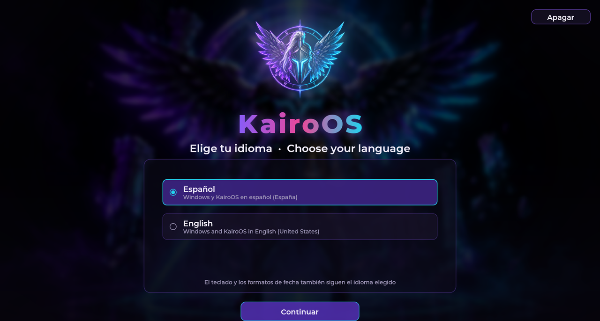
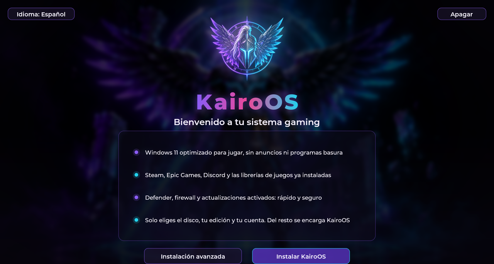
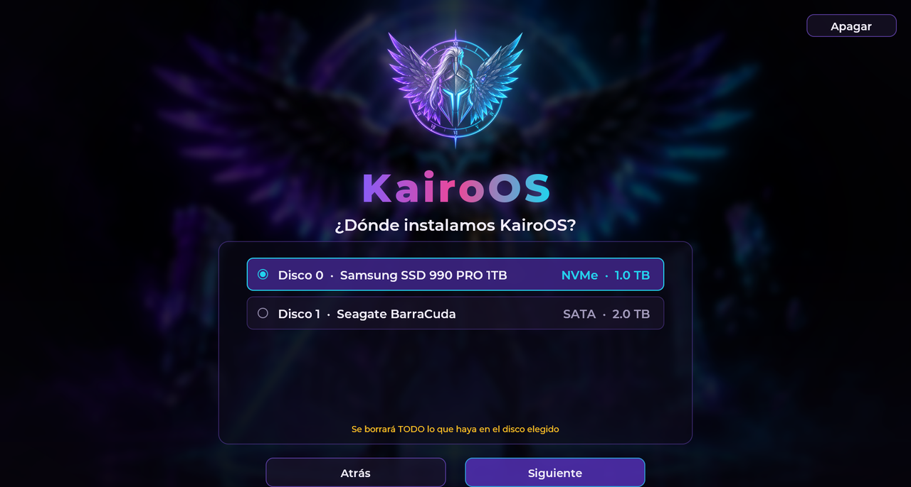
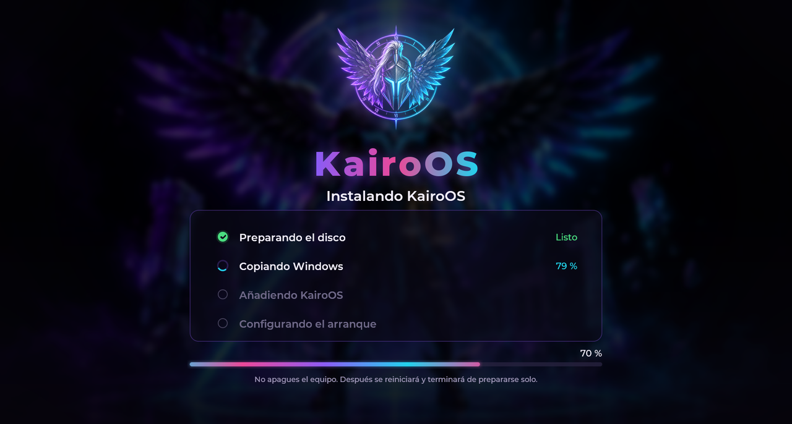
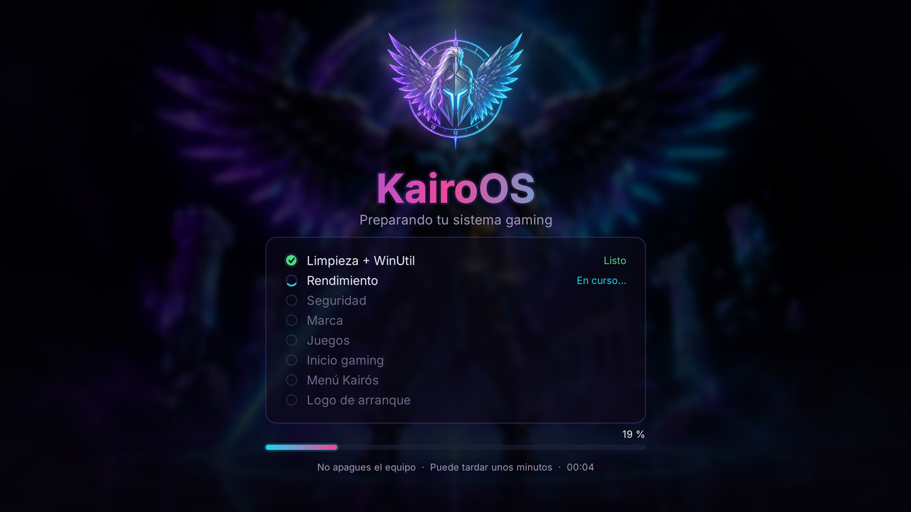
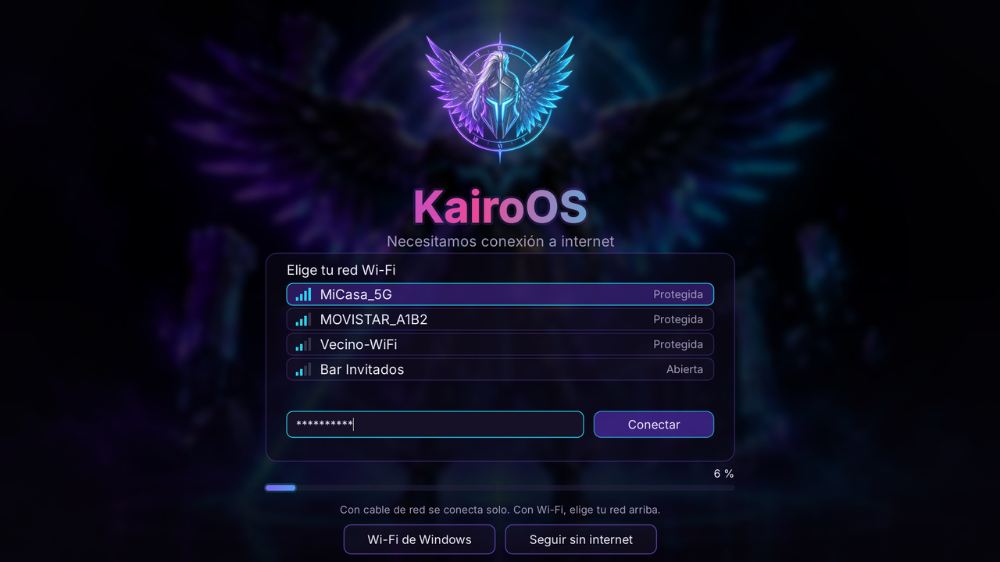
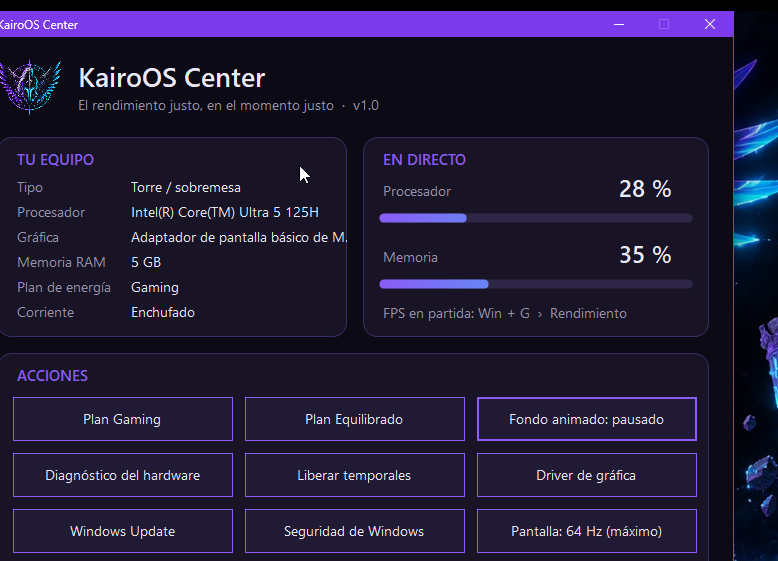

  

  <b>Windows 11 preparado para jugar: limpio, rápido, seguro y con estilo propio.</b> 
  <i>Windows 11 tuned for gaming: clean, fast, secure and with its own style.</i>

  
  
  

---

## ¿Qué es KairoOS?

KairoOS es **Windows 11 de verdad**, el oficial de Microsoft, preparado automáticamente para jugar.

Lo instalas desde un USB como cualquier Windows. En unos 20-30 minutos tienes un sistema:
- **Sin programas basura** ni anuncios.
- **Ajustado para rendimiento.**
- **Con Steam, Epic Games, Discord y las librerías de juegos** ya instaladas.
- **Con su propia identidad visual:** instalador, fondo animado, menú Inicio, logo de arranque y panel de control.

Sin pantallas de configuración de Windows, sin cuenta de Microsoft obligatoria y **sin quitar la seguridad**.

> KairoOS **no reparte Windows**. Con **KairoOS Creator** usas tu propia ISO oficial de Windows 11, que se descarga gratis de Microsoft. El programa crea a partir de ella tu ISO de KairoOS. Es el mismo modelo que siguen otros proyectos conocidos de Windows optimizado.

---

## Novedades de la versión 1.0

- **Instalador propio de KairoOS:** idioma, disco, edición (Home o Pro) y cuenta local en 4 pantallas. Sin las pantallas de Windows.
- **Español e inglés:** el instalador, las pantallas de KairoOS y el propio Windows quedan en el idioma que elijas.
- **Wi-Fi integrado:** si no hay cable de red, KairoOS te enseña las redes Wi-Fi en su propia pantalla para conectarte durante la instalación.
- **Instalación invisible:** todo ocurre bajo la pantalla "Preparando tu sistema". No se ven ventanas de comandos ni el menú Inicio.
- **Chris Titus Tech WinUtil** integrado: aplica automáticamente sus ajustes recomendados durante la instalación.
- **Fondo animado RGB ligero:** se decodifica en la tarjeta gráfica y se pausa solo al jugar a pantalla completa o con batería.
- **Energía inteligente:**
  - **En torre:** plan Gaming fijo.
  - **En portátil:** máximo rendimiento enchufado y ahorro con batería, cambiando solo. Funciona también en portátiles modernos con "Modern Standby".
- **Logo de arranque propio**, compatible con Secure Boot, con guía paso a paso.
- **Mantenimiento tras actualizaciones grandes de Windows:** KairoOS te ofrece volver a aplicar sus ajustes con un clic.
- **KairoOS Center**, el panel de control de KairoOS:
  - Hercios máximos de la pantalla con un clic.
  - Planes de energía.
  - Interruptores de rendimiento.
  - Diagnóstico del equipo.

---

## Capturas

| Elige tu idioma | Bienvenida |
|---|---|
|  |  |
| **Elige el disco** | **Tu cuenta local** |
|  |  |
| **Instalando** | **Preparando tu sistema** |
|  |  |
| **Wi-Fi integrado** | **KairoOS Center** |
|  |  |

---

## Qué hace KairoOS, paso a paso

En el primer inicio, KairoOS aplica 8 pasos (9 si eliges un idioma distinto al de tu ISO). Cada uno se ve en pantalla y queda registrado.

| Paso | Qué hace |
|---|---|
| **Limpieza + WinUtil** | Crea un **punto de restauración**. Quita apps preinstaladas que no se usan, OneDrive, sugerencias y anuncios, y reduce la telemetría. Además aplica los ajustes recomendados de WinUtil. |
| **Rendimiento** | Plan de energía Gaming o modo "Mejor rendimiento", prioridad de los juegos (MMCSS), ajustes de red para menos latencia y servicios innecesarios en manual. |
| **Seguridad** | **Comprueba y refuerza** Microsoft Defender, el firewall, el control de cuentas (UAC) y Windows Update. Desactiva SMBv1 y la ejecución automática de USB. No quita nada de seguridad. |
| **Marca** | Fondo animado RGB, pantalla de bloqueo, colores e información del sistema de KairoOS. |
| **Juegos** | Steam, Epic Games y Discord, más las librerías que piden los juegos: Visual C++ 2008-2022, DirectX 9-11 y .NET 8. |
| **Inicio gaming** | Menú Inicio ordenado, accesos a Ninite y WinUtil, y los launchers sin arrancar solos con Windows. |
| **Menú Kairós** | Barra de tareas y menú Inicio con el estilo de KairoOS (mods de Windhawk). |
| **Logo de arranque** | Logo de KairoOS al encender el equipo (HackBGRT). Funciona con Secure Boot. |
| **Idioma** *(si hace falta)* | Descarga e instala el idioma elegido en Windows. |

---

## ¿Por qué es fiable?

- **Es Windows oficial.** Partes de **tu propia ISO de Microsoft**: sin versiones "pirata", sin activadores y sin archivos de origen desconocido.
- **La seguridad se queda activada.** Defender, firewall, UAC, Secure Boot, TPM y Windows Update siguen funcionando. Muchas ISO "gaming" los quitan para ganar unos MB; KairoOS no.
- **Recibe actualizaciones.** Windows Update funciona normal, y tras una actualización grande KairoOS ofrece reaplicar sus ajustes.
- **Tiene marcha atrás.** Antes de tocar nada crea un punto de restauración.
- **Es transparente.** Cada paso deja su registro en `C:\ProgramData\KairoOS\logs`, y en pantalla ves qué paso salió bien y cuál dio algún aviso.
- **Usa herramientas conocidas y de código abierto:** [Chris Titus Tech WinUtil](https://github.com/ChrisTitusTech/winutil), [HackBGRT](https://github.com/Metabolix/HackBGRT) y [Windhawk](https://windhawk.net/). Todo lo demás se descarga de sus fuentes oficiales: winget, Microsoft, Steam, Epic, Discord.
- **No promete magia.** KairoOS quita lo que sobra y ajusta lo que importa para jugar. No inventa cifras de FPS: la ganancia real depende de tu equipo y tus juegos.

---

## KairoOS frente a otras opciones

| | Windows normal | ISO "gaming" modificada típica | **KairoOS** |
|---|:---:|:---:|:---:|
| Windows oficial de Microsoft | ✅ | ❓ Origen dudoso | ✅ Tu propia ISO |
| Sin apps basura ni anuncios | ❌ | ✅ | ✅ |
| Defender, firewall y Windows Update activos | ✅ | ❌ A menudo quitados | ✅ |
| Compatible con Secure Boot y TPM | ✅ | ⚠️ Depende | ✅ |
| Sin cuenta de Microsoft obligatoria | ❌ | ✅ | ✅ |
| Instalación sin pantallas de configuración | ❌ | ⚠️ Depende | ✅ Instalador propio |
| Launchers y librerías de juegos ya instalados | ❌ | ⚠️ Depende | ✅ |
| Energía automática en portátil (enchufado / batería) | ⚠️ Manual | ❌ | ✅ |
| Ajustes de nuevo tras actualizaciones grandes | — | ❌ | ✅ |
| Wi-Fi durante la instalación | ✅ | ⚠️ | ✅ Pantalla propia |
| Español e inglés | ✅ | ⚠️ | ✅ |
| Panel de control propio | ❌ | ❌ | ✅ KairoOS Center |
| Punto de restauración y registros | ❌ | ❌ | ✅ |

---

## Requisitos

- Un PC o portátil compatible con **Windows 11** (64 bits, UEFI, TPM 2.0 y Secure Boot recomendados).
- **Para crear la ISO** (en cualquier Windows 10/11):
  - La ISO oficial de Windows 11. Es gratis, desde la [página de Microsoft](https://www.microsoft.com/software-download/windows11).
  - Unos **20 GB libres**.
  - Internet, para la herramienta de Microsoft que crea la ISO. KairoOS Creator la instala sola si falta.
- **Un USB de 16 GB** o más, y [Rufus](https://rufus.ie/) para grabarla.
- **Una licencia de Windows 11.** La mayoría de equipos ya la traen de fábrica y se activa sola. KairoOS no incluye ni salta licencias.

---

## Cómo conseguir KairoOS

1. Descarga **KairoOS Creator** desde [Releases](https://github.com/pipeforero306-cyber/karioOS-gaming/releases/latest).
2. Descarga la **ISO oficial de Windows 11** de Microsoft.
3. Abre KairoOS Creator, elige tu ISO y pulsa **Crear KairoOS**. Tarda unos 10-20 minutos.
4. Graba `KairoOS.iso` en un USB con **Rufus**.
5. Arranca el equipo desde el USB y sigue el instalador de KairoOS.

La guía completa, con capturas y consejos, está en [docs/INSTALAR.md](docs/INSTALAR.md). Las preguntas frecuentes, en [docs/PREGUNTAS.md](docs/PREGUNTAS.md).

---

## Aviso legal

KairoOS es un proyecto independiente y **no está afiliado, patrocinado ni aprobado por Microsoft**. Windows es una marca de Microsoft Corporation. KairoOS no distribuye Windows: KairoOS Creator trabaja con la ISO oficial que descarga cada usuario, y para usar Windows hace falta una licencia válida.

Los programas de terceros que usa KairoOS mantienen sus licencias: lo tienes en [TERCEROS.md](TERCEROS.md).

---

## English

**KairoOS** is genuine Windows 11, automatically tuned for gaming.
- **No bloatware**, **performance tweaks**, and **Steam, Epic Games, Discord and the game runtimes** preinstalled.
- **Its own look:** installer, animated wallpaper, Start menu, boot logo and KairoOS Center.
- **Security stays on:** Defender, firewall, Secure Boot, TPM and Windows Update.
- **No Microsoft account required** and **no Windows setup screens.**
- Available in **English and Spanish.**

KairoOS does **not** distribute Windows. Download **KairoOS Creator** from [Releases](https://github.com/pipeforero306-cyber/karioOS-gaming/releases/latest), pick your official Windows 11 ISO (free from Microsoft), and it builds your KairoOS ISO. Then write it to a USB drive with Rufus and install. A valid Windows license is required. KairoOS is not affiliated with Microsoft.
